**RU** · [EN](README_EN.md)　 /　 [Каталог проектов](https://github.com/mrjakeball/portfolio)

<picture>
  <source media="(prefers-color-scheme: dark)" srcset="assets/ru-dark.svg">
  
</picture>

Учусь на направлении «Информационные системы и технологии» во ВВГУ, Владивосток. Разрабатываю учебные веб-приложения и изучаю AppSec, QA и DevOps. Здесь показываю, как устроены проекты, что именно проверял и какие результаты сохранил.

## Инженерная практика

**[Application Security · AppSec Labs](https://github.com/mrjakeball/appsec-labs)**  
В трёх работах PortSwigger разбираю, кто может выполнить действие и к чьим данным оно даёт доступ. Ещё в двух сравниваю предупреждения Bandit и Semgrep до и после правок в Python.

**[QA · Postman](https://github.com/mrjakeball/qa-learning-portfolio)**  
Начальная коллекция содержит 11 проверок для трёх запросов. В отдельной [работе по REST API](https://github.com/mrjakeball/appsec-labs/blob/main/api-testing/01-rest-api-fundamentals/README.md) сохранён запуск 34 проверок и описана последующая правка экспорта.

## Избранные проекты

### [Кодограф ВВГУ](https://github.com/mrjakeball/kodograf-vvgu-showcase)

Урок, редактор и результат Python в одной вкладке. Monaco отвечает за ввод кода, Pyodide выполняет его в отдельном Web Worker.

### [Linux & DevOps Trainer](https://github.com/mrjakeball/linux-devops-trainer-showcase)

Тема о файловой системе переходит в практику с командами. Тренажёр обрабатывает их в симуляторе и отдельно хранит логику упражнений.

### [TEMPO PULSE](https://github.com/mrjakeball/tempo-pulse-showcase)

Мобильный дневник объединяет тренировки, питание и прогресс. Основные записи хранятся на устройстве.

[Все проекты и демоверсии →](https://github.com/mrjakeball/portfolio)

## С чем работаю

**Разработка**　Python, TypeScript, React, Git  
**Проверки**　Burp Suite Community, Bandit, Semgrep, Postman  
**Инфраструктура**　изучаю Linux и Docker

## GitHub

[12 публичных репозиториев](https://github.com/mrjakeball?tab=repositories) · [Активность и вклад](https://github.com/mrjakeball#js-contribution-activity)  
Срез на 24 ноября 2026 года

## Контакты

[Telegram · @a1e5hka](https://t.me/a1e5hka)　·　[kuzmin_aleksey2004@mail.ru](mailto:kuzmin_aleksey2004@mail.ru)　·　[GitHub](https://github.com/mrjakeball)
