<picture>
  <source media="(prefers-color-scheme: dark)" srcset="assets/inlay-ru-dark.svg">
  
</picture>

<a href="README.md"><picture><source media="(max-width: 600px)" srcset="https://raw.githubusercontent.com/mrjakeball/mrjakeball/df4dc8d1f2816fd3ce9d8c316b6ed728b5015d71/assets/navigation/ru-on-compact.svg"></picture></a>
<a href="README_EN.md"><picture><source media="(max-width: 600px)" srcset="https://raw.githubusercontent.com/mrjakeball/mrjakeball/df4dc8d1f2816fd3ce9d8c316b6ed728b5015d71/assets/navigation/en-off-compact.svg"></picture></a>
<a href="https://github.com/mrjakeball/portfolio"><picture><source media="(max-width: 600px)" srcset="https://raw.githubusercontent.com/mrjakeball/mrjakeball/df4dc8d1f2816fd3ce9d8c316b6ed728b5015d71/assets/navigation/catalog-ru-compact.svg"></picture></a>

Изучаю информационные системы и технологии в ВВГУ, Владивосток. Разрабатываю учебные веб-приложения и тренажёры. В AppSec и QA разбираю конкретные вопросы: кто может прочитать запись, какие данные принимает API и что меняется после исправления кода.

<h2><picture><source media="(prefers-color-scheme: dark)" srcset="https://raw.githubusercontent.com/mrjakeball/mrjakeball/df4dc8d1f2816fd3ce9d8c316b6ed728b5015d71/assets/ui/practice-ru-dark.svg"></picture></h2>

| Направление | Что можно посмотреть |
| --- | --- |
|  | Разбор прав доступа в PortSwigger. Отчёты Bandit и Semgrep до и после правок в Python. |
|  | Коллекция Postman для JSONPlaceholder. Проверки HTTP-статуса, полей ответа и запроса отсутствующей записи. |

<h2><picture><source media="(prefers-color-scheme: dark)" srcset="https://raw.githubusercontent.com/mrjakeball/mrjakeball/df4dc8d1f2816fd3ce9d8c316b6ed728b5015d71/assets/ui/projects-ru-dark.svg"></picture></h2>

**Кодограф ВВГУ**　Студент решает задачу в Monaco и видит вывод Python в той же вкладке. Выполнение кода вынесено в Web Worker.

**Linux & DevOps Trainer**　От теории файловой системы — к командам в учебном терминале. Симулятор меняет состояние упражнения, не обращаясь к оболочке компьютера.

**TEMPO PULSE**　Питание, сон и следующая тренировка собраны в сводке дня. Основные записи дневника остаются на устройстве.

<h2><picture><source media="(prefers-color-scheme: dark)" srcset="https://raw.githubusercontent.com/mrjakeball/mrjakeball/df4dc8d1f2816fd3ce9d8c316b6ed728b5015d71/assets/ui/tools-ru-dark.svg"></picture></h2>

| Задача | Инструменты |
| --- | --- |
| Пишу приложения | Python, TypeScript, React, Git |
| Проверяю код и API | Bandit, Semgrep, Postman, Burp Suite Community |
| Осваиваю инфраструктуру | Linux, Docker |

<h2><picture><source media="(prefers-color-scheme: dark)" srcset="assets/ui/envelope-ru-dark.svg"></picture></h2>

