<picture>
  <source media="(prefers-color-scheme: dark)" srcset="assets/inlay-en-dark.svg">
  
</picture>

<a href="README.md"><picture><source media="(max-width: 600px)" srcset="https://raw.githubusercontent.com/mrjakeball/mrjakeball/df4dc8d1f2816fd3ce9d8c316b6ed728b5015d71/assets/navigation/ru-off-compact.svg"></picture></a>
<a href="README_EN.md"><picture><source media="(max-width: 600px)" srcset="https://raw.githubusercontent.com/mrjakeball/mrjakeball/df4dc8d1f2816fd3ce9d8c316b6ed728b5015d71/assets/navigation/en-on-compact.svg"></picture></a>
<a href="https://github.com/mrjakeball/portfolio/blob/main/README_EN.md"><picture><source media="(max-width: 600px)" srcset="https://raw.githubusercontent.com/mrjakeball/mrjakeball/df4dc8d1f2816fd3ce9d8c316b6ed728b5015d71/assets/navigation/catalog-en-compact.svg"></picture></a>

I study Information Systems and Technologies at Vladivostok State University and build web apps and learning tools. My AppSec and QA work starts with concrete questions: who can read a record, what an API accepts, and what changes after a fix.

<h2><picture><source media="(prefers-color-scheme: dark)" srcset="https://raw.githubusercontent.com/mrjakeball/mrjakeball/df4dc8d1f2816fd3ce9d8c316b6ed728b5015d71/assets/ui/practice-en-dark.svg"></picture></h2>

| Practice | Inside the repository |
| --- | --- |
|  | Access-control observations from PortSwigger. Bandit and Semgrep findings before and after Python fixes. |
|  | A Postman collection for JSONPlaceholder covering status codes, response fields and missing records. |

<h2><picture><source media="(prefers-color-scheme: dark)" srcset="https://raw.githubusercontent.com/mrjakeball/mrjakeball/df4dc8d1f2816fd3ce9d8c316b6ed728b5015d71/assets/ui/projects-en-dark.svg"></picture></h2>

**Kodograf VVGU**　Students edit a solution in Monaco and read the Python output in the same tab. A Web Worker handles execution.

**Linux & DevOps Trainer**　A filesystem lesson leads into a simulated terminal. Commands update the exercise state without opening a system shell.

**TEMPO PULSE**　Meals, sleep and the next workout meet in one daily overview. The diary keeps its core records on the device.

<h2><picture><source media="(prefers-color-scheme: dark)" srcset="https://raw.githubusercontent.com/mrjakeball/mrjakeball/df4dc8d1f2816fd3ce9d8c316b6ed728b5015d71/assets/ui/tools-en-dark.svg"></picture></h2>

| Task | Tools |
| --- | --- |
| Building apps | Python, TypeScript, React, Git |
| Checking code and APIs | Bandit, Semgrep, Postman, Burp Suite Community |
| Learning infrastructure | Linux, Docker |

<h2><picture><source media="(prefers-color-scheme: dark)" srcset="assets/ui/envelope-en-dark.svg"></picture></h2>

