<picture>
  <source media="(prefers-color-scheme: dark)" srcset="assets/en-dark.svg">
  
</picture>

I study Information Systems and Technologies at Vladivostok State University and build web apps and learning tools. My AppSec and QA work starts with concrete questions: who can read a record, what an API accepts, and what changes after a fix.

<h2><picture><source media="(prefers-color-scheme: dark)" srcset="assets/ui/practice-en-dark.svg"></picture></h2>

| Practice | Inside the repository |
| --- | --- |
| **[AppSec Labs](https://github.com/mrjakeball/appsec-labs/blob/main/README_EN.md)** | Access-control observations from PortSwigger. Bandit and Semgrep findings before and after Python fixes. |
| **[API Testing](https://github.com/mrjakeball/qa-learning-portfolio/blob/main/README_EN.md)** | A Postman collection for JSONPlaceholder covering status codes, response fields and missing records. |

<h2><picture><source media="(prefers-color-scheme: dark)" srcset="assets/ui/projects-en-dark.svg"></picture></h2>

**Kodograf VVGU**　Students edit a solution in Monaco and read the Python output in the same tab. A Web Worker handles execution.

[Explore the editor ↗](https://github.com/mrjakeball/kodograf-vvgu-showcase/blob/main/README_EN.md)

**Linux & DevOps Trainer**　A filesystem lesson leads into a simulated terminal. Commands update the exercise state without opening a system shell.

[Explore the lesson ↗](https://github.com/mrjakeball/linux-devops-trainer-showcase/blob/main/README_EN.md)

**TEMPO PULSE**　Meals, sleep and the next workout meet in one daily overview. The diary keeps its core records on the device.

[Explore the diary ↗](https://github.com/mrjakeball/tempo-pulse-showcase/blob/main/README_EN.md)

**[Full project catalogue →](https://github.com/mrjakeball/portfolio/blob/main/README_EN.md)**

<h2><picture><source media="(prefers-color-scheme: dark)" srcset="assets/ui/tools-en-dark.svg"></picture></h2>

| Task | Tools |
| --- | --- |
| Building apps | Python, TypeScript, React, Git |
| Checking code and APIs | Bandit, Semgrep, Postman, Burp Suite Community |
| Learning infrastructure | Linux, Docker |

<h2><picture><source media="(prefers-color-scheme: dark)" srcset="assets/ui/contact-en-dark.svg"></picture></h2>

**Telegram**　[@a1e5hka](https://t.me/a1e5hka)  
**Email**　[kuzmin_aleksey2004@mail.ru](mailto:kuzmin_aleksey2004@mail.ru)

GitHub · <a href="https://github.com/mrjakeball">@mrjakeball</a> · <a href="https://github.com/mrjakeball?tab=repositories">12 public repositories on 24 Nov 2026</a> · <a href="https://github.com/mrjakeball#js-contribution-activity">Contribution graph</a>
